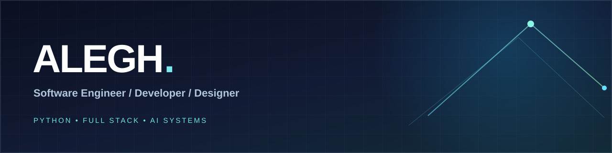

  

  <h1>Hi, I'm Alegh 👋</h1>
  <h3>Full-Stack Developer · UI/UX Designer · Motion & Graphic Designer</h3>

  
<strong>I don't just build applications. I design how they look, feel, and work.</strong>

  
From scalable backends and interactive frontends to thoughtful interfaces, motion graphics, and bold visual identities — I bring engineering and design together to create complete digital experiences.

  
  
  
  

---

### ✦ What I do

| 💻 Full-Stack Engineering | 🎯 UI/UX & Product Design |
| --- | --- |
| Build responsive web applications, reliable APIs, backend services, database systems, and cloud-ready architectures. | Design clear user journeys, polished interfaces, wireframes, prototypes, design systems, and engaging digital products. |
| 🎬 **Motion Graphics & Animation** | 🎨 **Graphic Design & Branding** |
| Create visual motion, animated interfaces, transitions, kinetic typography, and storytelling through animation. | Shape brand identities, layouts, visual assets, typography, and graphics with consistency and attention to detail. |

### ⚡ Development stack

**Frontend**

**Backend, APIs & databases**

**Cloud, tools & automation**

### ✨ Design & creative toolkit

**UI/UX:** User flows · Wireframing · Prototyping · Design systems · Responsive interfaces  
**Motion:** Motion graphics · Kinetic typography · Transitions · UI animation · Visual storytelling  
**Graphics:** Branding · Layouts · Typography · Visual composition · Digital assets

### 🧠 My approach

> **Think like a designer. Build like an engineer. Refine every detail.**
>
> I care about clean architecture, intuitive interaction, consistent visual language, smooth motion, and the small details that make software feel exceptional.

### 🤝 Connect

  
Engineering + Design + Motion = Digital experiences built end to end.

  

